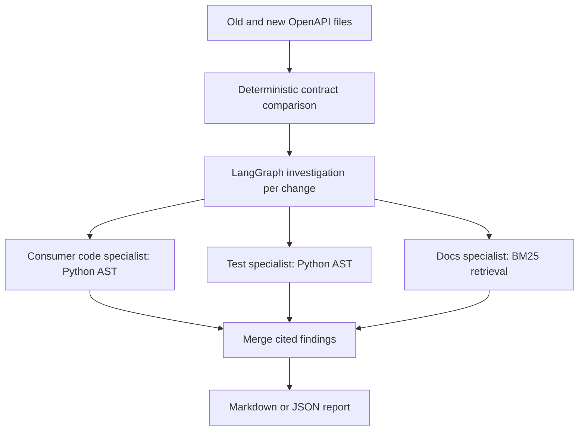

# API Change Impact Assistant

Review a third-party API upgrade against the Python application that consumes it. The assistant takes two OpenAPI files and a local checkout, then produces a report with candidate call sites, tests, migration guidance, and follow-up checks.

Run the CLI without credentials to collect evidence, or enable local Ollama for model-assisted investigation. The tool is read-only and intended for engineers reviewing an upgrade.

## Quick start

Run these commands from the repository root with Python 3.11+ and `uv`.

```sh
uv sync --locked
uv run --locked python -m impact_assistant examples/payments/before.yaml examples/payments/after.yaml examples/payments/consumer
```

The bundled synthetic example has three changes. `POST /payments` now requires `currency` and its `201` response loses `receipt_url`. The report points to the consumer call and test, with the relevant migration note. `GET /legacy-payments` was removed and the report says **No direct usage found** for that operation.

See the [sample report](docs/sample-report.md) for the exact output. For your own checkout, substitute the paths to the two contracts and the consumer repository:

```sh
uv run --locked python -m impact_assistant old.yaml new.yaml ./consumer --format json > report.json
```

The default output is Markdown. Exit status `0` means the analysis ran successfully, including when changes are found. Exit status `1` indicates an analysis error.

### Run the model specialists locally

Start [Ollama](https://docs.ollama.com/), install a model that supports structured output, and pass its name. The example uses `qwen2.5:7b`.

```sh
ollama pull qwen2.5:7b
uv run --locked python -m impact_assistant examples/payments/before.yaml examples/payments/after.yaml examples/payments/consumer --ollama-model qwen2.5:7b
```

The CLI sends retrieved excerpts and change details to the local Ollama API on `127.0.0.1:11434`. Each specialist interprets evidence from its own search. The graph validates the returned structure and citation IDs. Review model observations against the excerpts before making a migration decision.

## How it works



- The contract comparison runs before the graph. The same rules apply with and without the model.
- The code and test searches match HTTP method and route in Python calls. A match is evidence of possible usage. The report includes repository-relative file paths, line numbers, and excerpts.
- The docs branch indexes overlapping Markdown chunks in memory and retrieves the highest scoring chunks with BM25. With a model enabled, those chunks ground the documentation specialist's answer. This is lexical RAG and uses no embedding API.
- The three branches write separate fields in LangGraph state. The report node waits for all three. Evidence-only mode runs the same searches and generates the report without model calls.
- Each finding includes open questions selected from the change type and gaps in the available evidence. For example, an unmatched operation prompts a check for indirect calls through shared clients or generated SDKs.

## Coverage

The comparison supports OpenAPI 3.x YAML and JSON, local object references, removed operations, newly required top-level JSON request properties, and removed declared top-level JSON response properties on matching explicit `2xx` status codes. Complex or unmatched JSON schemas can produce coverage warnings. Parameter changes, nested and composed schemas, security schemes, external references, and behavioral changes require other checks.

Source matching covers common literal URLs and simple f-strings. It cannot trace arbitrary variables, wrappers, generated SDKs, or runtime traffic. **No direct usage found** means the search did not find a call in the supported patterns. Route matches can also include calls to a different provider with the same path. Reports can contain repository excerpts, so handle them like the source material. The CLI reads the checkout without importing or executing its Python code.

## Verification

```sh
uv run --locked python -m unittest discover -s tests -v
```

The tests check the complete sample report, an unchanged contract, invalid input, route matching, rejection of invented citation IDs, and the Ollama response handling using a mocked server response. They run without model weights or API keys.

Licensed under [MIT](LICENSE).

See the [changelog](CHANGELOG.md) for releases and [contributing guide](CONTRIBUTING.md) for how to report a problem or propose a change.
